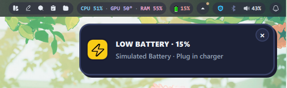
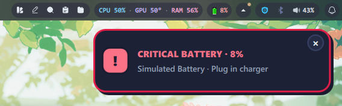
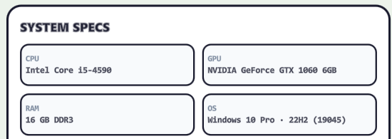
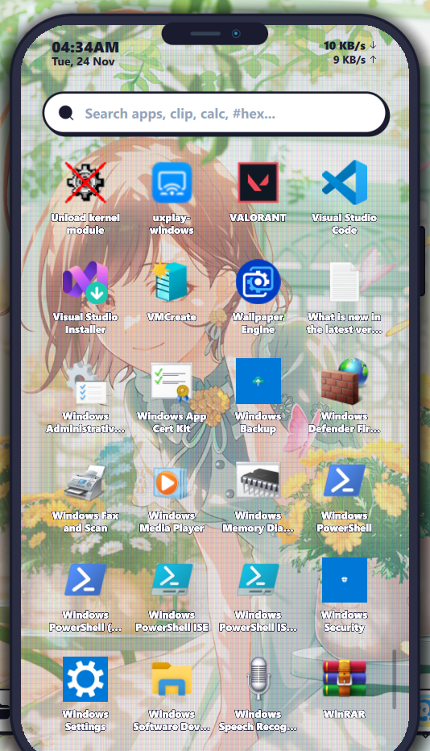

<div align="center">

# ✨ SekaiDesk

**Project Sekai Pop-Comic Desktop Shell for Windows 10 & Windows 11**

[Showcase](#showcase) &nbsp;|&nbsp; [Features](#features) &nbsp;|&nbsp; [Benchmarks](#benchmarks) &nbsp;|&nbsp; [Requirements](#requirements) &nbsp;|&nbsp; [Installation](#installation) &nbsp;|&nbsp; [Keybinds](#keybinds) &nbsp;|&nbsp; [Credits](#credits)

<br>

<div align="left">

> ✨ **Native Windows 10 & Windows 11 (64-bit) Support**
>
> Built and verified across both **Windows 10** and **Windows 11 (22H2 / 23H2 / 24H2+)** — including native Win11 XAML System Tray capture via `SekaiTrayHook.dll`, AppBar workarea reservation, native taskbar suppression with `--restore` failsafe, and zero-overhead Game Mode (`Hibernate` & `Zero-Footprint`).

</div>

<br>


<sub>Transparent Top Bar, Capsule Bottom Dock, real-time system stats (CPU / GPU / RAM), Windows 10 &amp; 11 system tray integration, weather readout, and interactive desktop widgets.</sub>

</div>


<h2 id="showcase"></h2>

<table>
<tr>
<td width="50%" valign="top">

<br><b>Quick Panel: a 2.5D smartphone control center</b><br>
Slide up the portrait phone with <kbd>Ctrl</kbd> + <kbd>Alt</kbd> + <kbd>A</kbd> (or click the right status pill) for Ethernet/Wi-Fi &amp; Bluetooth toggles, Game Mode &amp; Power Rail flyout (with 2-step Quit confirmation), microphone/speaker sliders, display brightness control, active SMTC media card, and notification feed. Incoming notifications also peek from the bottom-right corner.
</td>
<td width="50%" valign="top">

<br><b>Settings: flip the phone sideways</b><br>
Rotates the Quick Panel into a landscape Settings Hub with SekaiPop slanted keycap tiles, active-band left-to-right hover gradient wipe, quick band dots, and six structured pages: <b>01 Quick</b>, <b>02 General</b> (Unit palettes, Wallpaper Match &amp; Clock/Weather), <b>03 Bar</b>, <b>04 Desktop</b>, <b>05 Hotkeys &amp; System</b> (Game Mode, RTSS Guard, Taskbar Hide), and <b>06 About</b>.
</td>
</tr>
<tr>
<td colspan="2" valign="top">

<br><b>Edit Desktop: drag, resize &amp; customize everything live</b><br>
Toggle <b>Edit</b> from the Top Bar to freely drag widgets across monitors, resize them with live corner &amp; edge handles, and customize Bar styles (<i>Transparent</i> floating islands, <i>Blur</i> frosted glass, <i>Straight</i> solid edge), Dock styles &amp; keycaps, Views, Unit Themes, and Presets on the fly.
</td>
</tr>
<tr>
<td width="50%" valign="top">

<br>

<br><b>Low &amp; Critical Battery Alerts</b><br>
Native <code>GetSystemPowerStatus</code> monitoring pops crisp warning toasts at &le;20% and red critical alerts at &le;10% (which even surface over fullscreen Game Mode).
</td>
<td width="50%" valign="top">

<br><b>Built-in System Specs Viewer (06 &middot; About)</b><br>
Pure Win32 / DXGI / SMBIOS readout displays your <b>CPU</b>, <b>GPU + VRAM</b>, <b>RAM capacity &amp; DDR generation</b>, and <b>Windows OS build</b> right inside the About tab — zero shell subprocesses.
</td>
</tr>
<tr>
<td colspan="2" valign="top">

<br><b>Spotlight Command Hub (<kbd>Alt</kbd> + <kbd>Space</kbd>)</b><br>
Instant app launcher, live Alt-Tab window switcher, calculator, hex color picker, and quick shell commands inside a crisp Pop-Comic phone modal — works even over fullscreen games.
</td>
</tr>
</table>


<h2 id="features"></h2>

Built from the ground up with **Qt 6.8 Quick** and a native **C++20 Win32 / WinRT service layer** — no heavy Electron runtime, just crisp hardware-accelerated rendering and native Windows hooks.

<table>
<tr>
<td width="50%" valign="top">
<b>Cohesive Pop-Comic Block Language</b><br>
Every pill, toggle, slanted keycap tile, phone modal, and desktop widget shares the same ink outline, inner white ring, left-to-right active-band hover wipe, and hard offset drop shadow that springs cleanly on press.
</td>
<td width="50%" valign="top">
<b>7 Sekai Unit Themes + Live Wallpaper Match</b><br>
Switch instantly between <i>Virtual Singer</i>, <i>Leo/need</i>, <i>MORE MORE JUMP!</i>, <i>Vivid BAD SQUAD</i>, <i>Wonderlands×Showtime</i>, <i>Nightcord at 25:00</i>, and <i>Monochrome</i> — or extract a custom palette directly from your active Windows wallpaper.
</td>
</tr>
<tr>
<td valign="top">
<b>Interactive Multi-Monitor Desktop Widgets</b><br>
Draggable &amp; resizable widgets across multiple displays: <b>Clock</b> (Keys, Tower, Sticker, Stack styles), <b>Weather</b> (Open-Meteo °C/°F), <b>Calendar</b>, <b>Profile Card</b>, <b>To-Do</b>, <b>Notes</b>, Polaroid <b>Photo Frames</b> with Washi Tape, and real-time synced <b>Bilingual Lyrics</b> (LRCLIB + YouTube SMTC auto-scroll + live EN/VI subtitle toggle).
</td>
<td valign="top">
<b>Smart Top Bar, Dock &amp; Win10/11 Tray Hook</b><br>
Three distinct Top Bar modes (<i>Transparent</i> click-through floating pill islands, <i>Blur</i> frosted glass, <i>Straight</i> solid edge), active window &amp; media pill with seek/controls, live CPU/GPU/RAM telemetry, hybrid Windows 10 &amp; Windows 11 System Tray monitor (`SekaiTrayHook.dll` passive Explorer hook + `NOTIFYICON_VERSION_4`), pinned app launcher, and AppBar workarea reservation.
</td>
</tr>
<tr>
<td valign="top">
<b>True Zero-Overhead Game Mode</b><br>
Auto-detects fullscreen games (or toggle via <kbd>Ctrl</kbd> + <kbd>Alt</kbd> + <kbd>G</kbd>) with <b>Hibernate</b> mode (releases GPU textures, pauses services, enables Win11 EcoQoS, unhooks keyboard/WinEvent hooks for zero input latency) and <b>Zero-Footprint</b> mode (`--wait-game` ~2 MB pure-Win32 watchdog), plus 1-click RivaTuner (`RTSS`) hook exclusion.
</td>
<td valign="top">
<b>Custom Sekai OSD, GPU Shaders &amp; PowerTools</b><br>
Intercepts volume/brightness/theme keys with a Pop-Comic Sekai OSD, alongside an 11-mode hardware-accelerated `.qsb` WASAPI audio visualizer (<i>Tide, Ribbons, Aurora, Pulse, Scope, Mirror, Ring, Dots, Sekai, Bars, Wave</i>), <kbd>Alt</kbd> + <kbd>Space</kbd> Spotlight (works even over fullscreen games), Clipboard History, and Bookshelf Drop Shelf.
</td>
</tr>
<tr>
<td valign="top">
<b>Built-in Auto Updater (WinHTTP + SHA-256)</b><br>
Checks GitHub Releases silently on startup or on demand from <b>06 · About</b>, surfaces a floating SekaiPop update toast, verifies downloads against <code>SHA256SUMS.txt</code>, and self-updates both Installer (<code>/S</code>) and Portable ZIP builds with automatic relaunch.
</td>
<td valign="top">
<b>Stutter-Free RAM Cleaner (RamNuker Engine)</b><br>
Integrates native NT memory-list primitives from <b>RamNuker</b>: background auto-clean triggers safely at your RAM% threshold using <b>Priority-0 Standby List</b> only (zero game micro-stutter), plus a 1-click <b>CLEAN RAM (DEEP)</b> button in the TopBar telemetry popup &amp; Settings.
</td>
</tr>
</table>


<h2 id="benchmarks">📊 Performance Benchmarks &amp; Games Tested</h2>

All measurements below were captured directly on a **decade-old mid-range PC** (not a flagship developer rig) so you know exactly how SekaiDesk behaves on real everyday hardware:

- **Test Rig**: **Intel Core i5-4590** (4C/4T, 2014) &middot; **16 GB DDR3** &middot; **NVIDIA GeForce GTX 1060 6GB** &middot; **Windows 10 Pro**

| Scenario (`SekaiDesk.exe` only, 5s avg) | RAM (Task Mgr / PrivWS) | Working Set | GPU VRAM | CPU | GPU |
|---|---|---|---|---|---|
| **Desktop · Full Widgets + Visualizer + Spotify** | `417.1 MB` | `501.9 MB` | `347.6 MB` | `17.34%` | `8.38%` |
| **Desktop · Light Widgets (Clock, Weather, Lyrics)** | `415.6 MB` | `499.2 MB` | `352.6 MB` | `4.14%` | `3.87%` |
| **App Foreground (Occluded Desktop)** | `415.8 MB` | `500.4 MB` | `347.4 MB` | `3.91%` | `3.32%` |
| **In-Game · Genshin Impact Max (Game Mode: Hibernate)** | **`48.9 MB`** | **`61.1 MB`** | `399.5 MB` | **`2.42%`** | **`0%`** |

> [!NOTE]
> Under **Hibernate**, Game Mode drops RAM nearly **9×** (`417 MB -> 48.9 MB`) and brings GPU load down to **`0%`** while keeping the D3D11 context warm for instant Alt-Tab. Switching Game Mode to **Zero-Footprint** (`--wait-game`) exits the QML runtime completely down to a ~2 MB Win32 watchdog and **`0 MB` VRAM**.

<details>
<summary>Reproduce this benchmark yourself (PowerShell)</summary>

```powershell
$p = Get-Process -Name "SekaiDesk" | Select-Object -First 1
$cpu1 = $p.TotalProcessorTime; $samples = 5; $gpuSum = 0.0
for ($i = 0; $i -lt $samples; $i++) {
    $g = (Get-Counter "\GPU Engine(pid_$($p.Id)_*)\Utilization Percentage" -ErrorAction SilentlyContinue).CounterSamples | Measure-Object CookedValue -Sum
    if ($g.Sum) { $gpuSum += $g.Sum }; Start-Sleep -Seconds 1
}
$p.Refresh(); $cpu2 = $p.TotalProcessorTime
$cpuPct = [math]::Round((($cpu2 - $cpu1).TotalMilliseconds / ($samples * 1000 * [Environment]::ProcessorCount)) * 100, 2)
$privWS = [math]::Round(((Get-Counter "\Process(SekaiDesk*)\Working Set - Private").CounterSamples | Measure-Object CookedValue -Sum).Sum / 1MB, 1)
$wsMB   = [math]::Round($p.WorkingSet64 / 1MB, 1)
$vramMB = [math]::Round(((Get-Counter "\GPU Process Memory(pid_$($p.Id)_*)\Dedicated Usage").CounterSamples | Measure-Object CookedValue -Sum).Sum / 1MB, 1)
$gpuAvg = [math]::Round($gpuSum / $samples, 2)
"RAM(PrivWS)=${privWS}MB | WorkingSet=${wsMB}MB | VRAM=${vramMB}MB | CPU=${cpuPct}% | GPU=${gpuAvg}%"
```

</details>

### 🎮 Games Tested While Running SekaiDesk

- Counter-Strike 2 (`CS2`)
- Valorant
- Elden Ring Nightreign
- Elden Ring
- Ghost of Tsushima
- osu!
- Geometry Dash
- Genshin Impact
- Zenless Zone Zero


<h2 id="requirements"></h2>

| Component | Requirement / Notes |
|---|---|
| **Operating System** | **Windows 10 &amp; Windows 11 (64-bit)** |
| **Graphics / Runtime** | Direct3D 11 capable GPU (Qt 6.8 Quick RHI D3D11 backend; Qt runtime DLLs bundled in installer &amp; portable zip) |
| **Permissions** | Runs per-user (no admin UAC required); `SekaiTrayHook.dll` attaches passively to `explorer.exe` and auto-unloads on exit |
| **Build Toolchain** *(source only)* | CMake 3.21+, C11 &amp; C++20 compiler (MinGW-w64 GCC / LLVM-MinGW), Qt 6.8+ (`Quick`, `QuickControls2`, `Svg`, `ShaderEffect`) |


<h2 id="installation"></h2>

### Option 1 — Windows Installer (Recommended)

1. Download **`SekaiDesk-Setup.exe`** from the [latest GitHub Release](https://github.com/Yuukitake/SekaiDesk/releases/latest).
2. Run the setup wizard — choose your preferred installation folder (defaults to `%LocalAppData%\Programs\SekaiDesk`, no admin prompt required), optionally enable **Start with Windows**, and leave **"Launch SekaiDesk now"** checked on the final page to start immediately.

### Option 2 — Portable ZIP Build

1. Download **`SekaiDesk-win64.zip`** from the [latest GitHub Release](https://github.com/Yuukitake/SekaiDesk/releases/latest).
2. Extract the archive to any folder (e.g., `D:\Apps\SekaiDesk\`) keeping `SekaiTrayHook.dll` beside `SekaiDesk.exe`, and launch **`SekaiDesk.exe`**.

First launch starts automatically with **Peek Phone** notifications, **Clear Bottom Dock** (`Square Keycaps`, `48px`, Auto-Hide Dodge, **Files** tool), **Blur Top Bar**, and the **Clock** desktop widget (with Audio Visualizer ready on **Tide**), writing your settings to `%APPDATA%\SekaiDesk\sekaidesk.json`.

### 🛡️ VirusTotal Scans (`v0.3.4`)

- **Installer (`SekaiDesk-Setup.exe`)**: [View VirusTotal report](https://www.virustotal.com/gui/file/ebd88b3fa8862a2bfc7fb37f9e0f20848644b4911d48f0a5ed9bcf84f758f39a?nocache=1)
- **Portable ZIP (`SekaiDesk-win64.zip`)**: [View VirusTotal report](https://www.virustotal.com/gui/file/b7317209bfd21fc113f7d6c216bb55bb7e2e918ca32aaa18872b2fec621ae730?nocache=1)

<details>
<summary>CLI flags &amp; emergency taskbar restore</summary>

- `SekaiDesk.exe --restore` — Immediately restores the native Windows 10/11 taskbar and exits.
- `SekaiDesk.exe --instance <tag>` — Launch an isolated instance with its own mutex name for testing.
- `SekaiDesk.exe --fake-battery=<percent>` — Simulate a battery percentage (e.g., `15` for warning, `8` for critical) to preview low-battery alerts on desktop PCs.

</details>

### Option 3 — Build from Source

```powershell
git clone https://github.com/Yuukitake/SekaiDesk.git SekaiDesk
cd SekaiDesk
cmake -S . -B build -G Ninja -DCMAKE_BUILD_TYPE=Release
cmake --build build -j

# Deploy Qt 6 runtime DLLs & QML modules for standalone execution
New-Item -ItemType Directory -Force installer/stage | Out-Null
Copy-Item build/SekaiDesk.exe, build/SekaiTrayHook.dll installer/stage/
windeployqt --release --qmldir qml installer/stage/SekaiDesk.exe

# Optional: build Windows installer (requires NSIS / makensis)
makensis installer/SekaiDesk.nsi
```

> [!TIP]
> Ensure your Qt 6.8+ (`Core`, `Gui`, `Qml`, `Quick`, `Network`, plus QML runtime modules `Svg`, `QuickControls2`, `ShaderEffect`) bin folder and `windeployqt` are on `PATH`. Also include MinGW runtime DLLs (`libstdc++-6.dll`, `libgcc_s_seh-1.dll`, `libwinpthread-1.dll`) for `SekaiDesk.exe` (`SekaiTrayHook.dll` is pure Win32 C with zero MinGW runtime dependencies).


<h2 id="keybinds"></h2>

| Shortcut | Action |
|---|---|
| <kbd>Alt</kbd> + <kbd>Space</kbd> | Open **Spotlight** launcher, calculator &amp; quick commands (works over fullscreen games) |
| <kbd>Ctrl</kbd> + <kbd>Alt</kbd> + <kbd>A</kbd> | Toggle **2.5D Quick Panel** smartphone |
| <kbd>Ctrl</kbd> + <kbd>Alt</kbd> + <kbd>V</kbd> | Open **Clipboard History** popup |
| <kbd>Ctrl</kbd> + <kbd>Alt</kbd> + <kbd>G</kbd> | Toggle **Game Mode** (instant Hibernate / Zero-Footprint) |
| <kbd>Ctrl</kbd> + <kbd>Alt</kbd> + <kbd>T</kbd> | Temporarily **Show / Hide native Windows Taskbar** |
| <kbd>Volume Up</kbd> / <kbd>Down</kbd> / <kbd>Mute</kbd> | Show custom **Sekai Volume OSD** |
| <kbd>Esc</kbd> | Close / back out of active phone, Settings, or tool popup |

### 🤖 AI Stack

> *"yes this app is vibe coded, but not in a bad way"*
>
> anyway, here's my AI stack:
> - **Gemini 3.8 Flash**
> - **Gemini 4 Hydrogen**
> - **Grok 4.7**
> - **DeepSeek V4.1**


<h2 id="credits"></h2>

SekaiDesk stands on the shoulders of awesome open-source projects and APIs:

- **[SekaiPop](https://github.com/Blapples/SekaiPop)** — The original Linux / Quickshell desktop shell whose Pop-Comic design system, 2.5D phone metaphors, Edit Desktop workflow, and unit themes inspired and guided this Windows port (distributed upstream under GPL-3.0).
- **[Flow Launcher](https://github.com/Flow-Launcher/Flow.Launcher)** — Reference and UX inspiration for fast Alt+Space Spotlight application search, calculation, and command filtering on Windows.
- **Libraries & Data Services**
  - [Qt 6 Quick](https://www.qt.io/) (D3D11 RHI scene graph & QML UI)
  - Windows Win32 / WinRT APIs (SMTC media control, WASAPI audio capture/peaks, DWM window thumbnails, Shell tray hooks)
  - [Open-Meteo](https://open-meteo.com/) for forecast weather data & [LRCLIB](https://lrclib.net/) for synchronized lyrics

> *Character themes and unit names are fan references to Project SEKAI COLORFUL STAGE! feat. Hatsune Miku. This is an unofficial fan project and is not affiliated with SEGA, Colorful Palette, or Crypton Future Media.*


